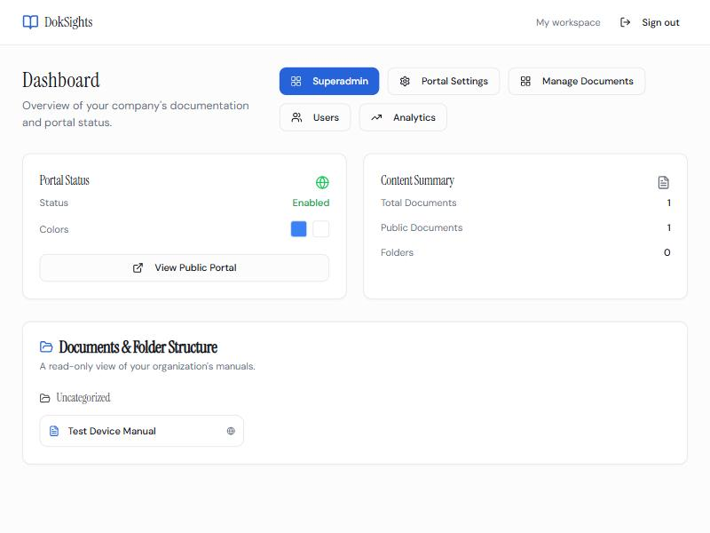
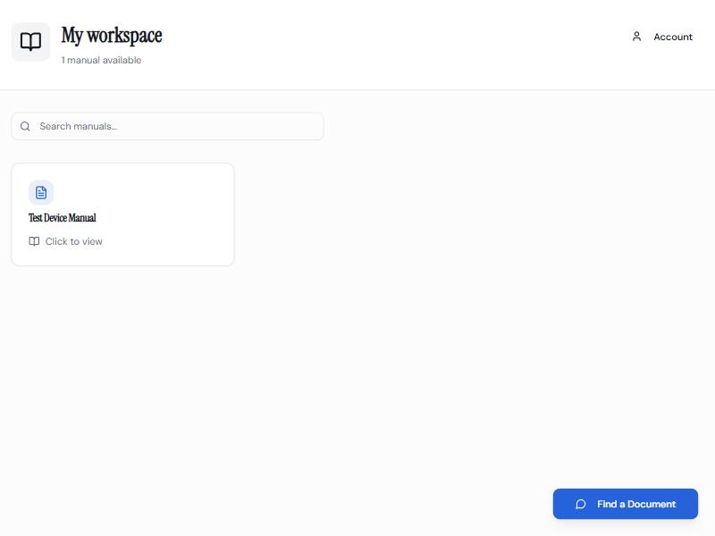
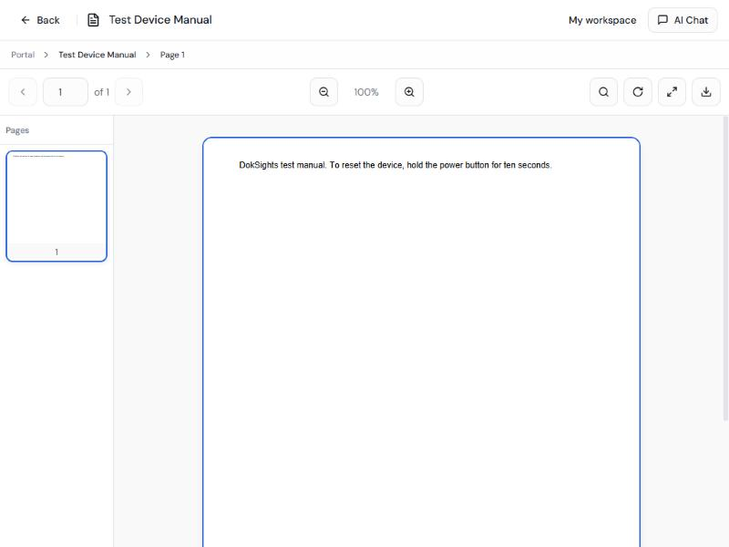
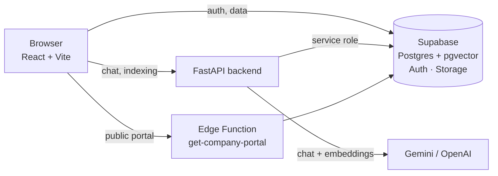

<div align="center">

# 📖 DokSights

**Turn your PDFs and docs into a searchable portal with an AI assistant that answers from your own documentation.**

Upload manuals, publish them in a branded portal, and let readers ask questions in plain language.
Answers come from your documents (RAG), and analytics show what people are looking for.

Self-hosted · Supabase + FastAPI + React · Google Gemini or OpenAI

[](LICENSE)

</div>



| Public portal | Document viewer with AI chat |
|---|---|
|  |  |

---

## ✨ Features

- **Document library**: upload PDFs or write web manuals in the built-in editor, then organize them in folders.
- **RAG chat**: every document is chunked and embedded into `pgvector`. Readers chat with one document, or ask "which manual covers X?" across all of them.
- **Branded portal**: public or private (invite-only) portal per workspace, with your logo and colors, at `/company/<slug>`.
- **Analytics**: views, reading time and popular documents. AI groups chat questions into themes so you can see what people struggle with.
- **Teams and permissions**: invite users per workspace with granular permissions (documents, portal, users, analytics).
- **Optional limits**: set a monthly AI token budget per workspace if you need one. By default there are no limits.

## 🧱 How it works



1. You upload a PDF, which goes to Supabase Storage. The backend extracts the text, splits it into chunks, and stores the embeddings in `manual_chunks`.
2. When someone asks a question, the backend embeds it, finds the closest chunks with vector search, and streams an answer grounded in them.
3. Row-level security in Postgres keeps every workspace's data separate. The backend verifies Supabase JWTs (HS256 or JWKS).

More detail is in [docs/architecture.md](docs/architecture.md) and [docs/functionalities](docs/functionalities/_index.md).

## 🚀 Quickstart (local, about 10 minutes)

**You need:** [Docker](https://docs.docker.com/get-docker/), the [Supabase CLI](https://supabase.com/docs/guides/cli/getting-started), and an API key for [Google AI Studio](https://aistudio.google.com/apikey) (free tier works) or OpenAI.

### 1. Clone and start Supabase

```bash
git clone https://github.com/albertarla/doksights-oss.git
cd doksights-oss
supabase start
```

`supabase start` runs Postgres, Auth, Storage and Edge Functions locally. It also applies every migration in `supabase/migrations`, which creates the tables, storage buckets, permissions and the default license.

### 2. Configure

```bash
cp .env.example .env
supabase status -o env   # prints the local URLs and keys you need below
```

Fill in `.env`:

| `.env` variable | Value |
|---|---|
| `VITE_SUPABASE_URL`, `SUPABASE_URL` | `API_URL` (normally `http://127.0.0.1:54321`) |
| `VITE_SUPABASE_PUBLISHABLE_KEY` | `ANON_KEY` |
| `SUPABASE_SERVICE_KEY` | `SERVICE_ROLE_KEY` (server-side only, never put it in a `VITE_` variable) |
| `SUPABASE_JWT_SECRET` | `JWT_SECRET` |
| `SUPABASE_URL_FROM_DOCKER` | uncomment it: `http://host.docker.internal:54321` |
| `AI_PROVIDER` + key | `google` with `GOOGLE_API_KEY`, or `openai` with `OPENAI_API_KEY` |

### 3. Run

```bash
docker compose up --build
```

- App: **http://localhost:8080**
- API docs: http://localhost:8000/docs
- Local emails (sign-up confirmations, invites): http://127.0.0.1:54324

### 4. Create the admin account

Open http://localhost:8080, choose **Need an account? Create one**, and sign up.
**The first account on a new instance becomes the instance admin** and gets a workspace called "My workspace" with every permission. From there:

1. **Manage Documents → Upload PDF**: indexing starts automatically (status "AI Context").
2. **Portal Settings**: turn on the portal, set your logo and colors, choose public or private.
3. **Users**: invite teammates. **Superadmin**: create more workspaces.

<details>
<summary><b>Run without Docker (frontend and backend on your machine)</b></summary>

```bash
# Backend (Python 3.11+)
cd backend
pip install -r requirements.txt
cp ../.env .env
uvicorn app.main:app --reload --port 8000

# Frontend (Node 20+), in another terminal
cd frontend
npm ci
cp ../.env .env
npm run dev          # http://localhost:8080
```

Without Docker, leave `SUPABASE_URL_FROM_DOCKER` commented out.
</details>

## ☁️ Deploying

| Piece | Where | How |
|---|---|---|
| Database, Auth, Storage | [Supabase](https://supabase.com) (hosted) or [self-hosted Supabase](https://supabase.com/docs/guides/self-hosting) | `supabase link --project-ref <ref>`, then `supabase db push`, then `supabase functions deploy get-company-portal` |
| Backend | Any Docker host (Render, Fly.io, Cloud Run…) | Build `backend/Dockerfile`. There's an example [`backend/render.yaml`](backend/render.yaml). Set the env vars from `.env.example`. |
| Frontend | Any static host (Vercel, Netlify, Cloudflare Pages, nginx) | `npm run build` with the `VITE_*` vars set; [`frontend/Dockerfile.prod`](frontend/Dockerfile.prod) serves it with nginx |

In production, set `ENVIRONMENT=production` (hides `/docs`), set `CORS_ORIGINS` to your frontend URL, and in Supabase Auth set the **Site URL** and **Redirect URLs** to your frontend.

## ⚙️ Configuration

Every setting is documented in [`.env.example`](.env.example). The ones you're most likely to change:

| Variable | Default | What it does |
|---|---|---|
| `AI_PROVIDER` | `google` | `google` or `openai` |
| `GOOGLE_AI_MODEL` / `OPENAI_AI_MODEL` | `gemini-2.5-flash` / `gpt-4o` | Chat model |
| `EMBEDDING_MODEL`, `EMBEDDING_DIMENSIONS` | `models/gemini-embedding-001`, `1536` | Must match the `vector(1536)` column. If you change the dimension, change the schema too. |
| `RAG_CHUNK_SIZE`, `RAG_TOP_K` | `1200`, `5` | Chunking and retrieval |
| `CLASSIFICATION_ENABLED` | `true` | Background job that groups chat questions into themes for Analytics (uses AI tokens) |
| `MAX_MANUAL_SIZE_MB` | `20` | Upload limit (the backend keeps the storage bucket in sync) |
| `RESEND_API_KEY` | empty | Optional. Sends portal invite emails through [Resend](https://resend.com). |

Workspace limits (documents, users, AI tokens per month) live in the **Self-hosted** license (Superadmin → Licenses Configurations). Create stricter licenses if you host workspaces for others.

## 🗂️ Project structure

```
backend/            FastAPI app: chat, RAG indexing, analytics, portal, admin APIs
  app/routers/      HTTP endpoints
  app/services/     AI providers, RAG pipeline, Supabase access, classification
  tests/            pytest suite
frontend/           React + Vite + Tailwind + shadcn/ui
  src/pages/        Dashboard, document management, portal, analytics, admin
supabase/
  migrations/       Database schema, RLS policies, storage buckets, bootstrap data
  functions/        Edge Function serving the public portal
docs/               Architecture, feature specs and user guides
load_tests/         Locust load tests
.agent/             AI coding-agent rules and skills used to build this project
```

## 🧪 Tests

```bash
cd backend && python -m pytest        # backend
cd frontend && npm test               # frontend (Vitest)
```

## 🤖 Built with AI agents

The [`.agent/`](.agent) folder holds the rules and skills used while developing DokSights with AI coding agents: test engineers for the backend and frontend, a responsive-design reviewer, a spec architect, and rules such as "keep docs in sync" and "every change needs tests". They're a reusable example of how to steer an agent on a real codebase.

## 🤝 Contributing

Issues and pull requests are welcome. Please:

1. Open an issue first for larger changes.
2. Add or update tests (`backend/tests`, `*.test.tsx`).
3. Update the relevant file in `docs/` when behavior changes.

Never commit `.env` files or keys. A [gitleaks](https://github.com/gitleaks/gitleaks) config is included: `gitleaks dir .`

## 📄 License

[MIT](LICENSE): free to use, modify and distribute, including commercially. Keep the copyright notice.
